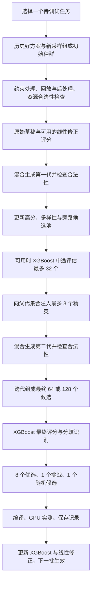

<!--
Licensed to the Apache Software Foundation (ASF) under one
or more contributor license agreements. See the NOTICE file
distributed with this work for additional information
regarding copyright ownership. The ASF licenses this file
to you under the Apache License, Version 2.0 (the
"License"); you may not use this file except in compliance
with the License. You may obtain a copy of the License at

  http://www.apache.org/licenses/LICENSE-2.0

Unless required by applicable law or agreed to in writing,
software distributed under the License is distributed on an
"AS IS" BASIS, WITHOUT WARRANTIES OR CONDITIONS OF ANY
KIND, either express or implied. See the License for the
specific language governing permissions and limitations
under the License.
-->

# Scout：结合实测反馈的草稿—验证与 GA 改进方案

日期：2026-10-28。状态：设计稿，待实现、待实验验证。

本次只形成方案，不修改算法、论文或运行队列，不启动 GPU 实验。
下述参数是第一版可复现的实验起点，不是已验证最优配置。
此前 A01/A02 的预检诊断继续保留；它们尚不能提供本方案的效果结论。

## 1. 目标与范围

在普通 CUDA / FP32 的 ResNet-18 调优中，保持有限实测预算下的方案质量，减少达到相近完整模型性能的时间。

提出五个相互衔接、可以单独关闭的机制：

1. 混合生成下一代：草稿引导、随机父代、新采样和精英延续并存。
2. 多样候选池：跨代保留草稿高分、结构不同和旁路探索候选。
3. 反悔机制：为草稿低估、但 XGBoost 看好的候选保留实测机会。
4. 一次中途纠偏：第一代变异完成后，XGBoost 评估少量候选并向第二代注入精英。
5. 轻量线性修正：用真实测量数据校准草稿的相对排序，保留原始解析模型。

不以减少 XGBoost 调用数本身作为成功标准，也不预设草稿一定优于单独使用 XGBoost。
资源合法性验证、性能预测和 GPU 实测分别计时，不能把三者都笼统称为“验证”。

## 2. 核心对象和边界

| 对象 | 含义 | 第一版建议 |
|---|---|---|
| 当前种群 P | 当前一代参与选择和变异的候选 | 上限 64 |
| 变异代数 G | 初始种群评分之后的变异次数 | 2，即初始、第一代、第二代共三轮草稿评分 |
| 中途验证池 M | 第一代之后交给 XGBoost 的候选 | 上限 32 |
| 注入精英 E | 中途评分后放回父代集合的未测候选 | 上限 8 |
| 最终验证池 K | 跨代汇集、最终交给 XGBoost 的候选 | 主配置 128，另比较 64 |
| 实测数量 B | 每批提交编译和运行的候选 | 上限 10，失败同样消耗提交预算 |
| 任务候选档案 | 本批跨代候选及本次运行留下的未测候选 | 每任务上限 256 条紧凑记录 |
| 线性训练窗口 | 每个任务族保留的有效测量样本 | 最近 512 个不同候选 |

P、M、E、K 独立配置。K 可以大于 P，来源是多代和本次运行的任务档案，不通过扩大 P 强行凑齐。
不足额时使用实际数量，记录原因，不复制候选填数，也不额外增加 GA 代数。

所有档案按任务隔离，不直接跨不同工作负载混用调度。只共享适用任务族的线性修正参数。
候选身份包含工作负载、目标硬件及结构标识；验证缓存还要绑定编译规则版本。

## 3. 单个测量批次的流程



每批开始冻结 XGBoost 和线性模型版本。中途纠偏只做预测，不训练，不用预测值充当真实标签。
GPU 反馈回来后才更新模型，避免同一批的候选评价标准不断变化。

首版草稿仍基于经过当前合法性检查的调度。将草稿特征前移到昂贵降低编译之前，作为后续独立改进，不能宣称本版已经省掉该阶段成本。

## 4. GA 的探索与延续

初始种群沿用约 20% 历史实测好方案、其余新采样的原则；无历史记录时从新采样开始。
后续每一代按照以下来源分配槽位，P=64 时采用固定整数配额：

| 来源 | 数量 | 规则 |
|---|---:|---|
| 草稿引导的变异后代 | 45 | 按当前修正草稿的排名概率选择父代，再变异 |
| 随机父代的变异后代 | 6 | 从当前父代集合均匀采样，不按草稿分数选择 |
| 全新候选 | 7 | 从任务的设计空间重新采样，经过相同合法性检查 |
| 精英延续 | 6 | 延续历史实测好方案或本批已获得 XGBoost 高分的不同候选 |

这四类直接定义下一代的产生方式，不再叠加旧的 0.85 变异开关，以免配额含义失真。
第一版保留原有变异操作及其内部权重，不同时引入自适应变异奖励。
草稿概率使用排名权重而非原始分数比值，例如排名 r 的权重为 1/sqrt(r)，避免极端分数垄断。

精英优先保留少量已实测的最好方案，再补充本批中途纠偏精英；缺少可靠精英时将剩余槽位给新采样。
中途注入的 E=8 是父代集合的容量上限，并不要求八个全部原样保留到下一代。
已测候选可作为父代，但必须从最终实测集合排除。

每类生成都有尝试次数和时间上限。达到上限后按实际合法候选运行，记录实际种群及来源。
初始建议把每批新候选尝试上限设为 16P、搜索软时间上限设为 300 秒；在生成/回放循环中检查，而不只是批次边界检查。
若预算先耗尽，直接对已有合法档案执行最终选择，记录实际完成的 GA 代数和中途纠偏是否执行。
这些限制也用于参数对齐的对照；单次不可中断的编译调用另由进程级超时保护。具体数值须在预检后冻结，不能在正式组间不同地调整。
仅一个合法候选时可以直接进入候选选择；没有候选时记录具体失败原因。
不得因为未凑满 P 或低于旧的 init_min_unmeasured，就无条件判定任务无解或空间耗尽。
适配缩小种群时必须同步修正父代索引和下一代数组逻辑，不能只改配置数值。

## 5. 多样候选池与旁路档案

候选先通过相同资源合法性检查，再以结构身份去重。只对未测候选构建实测候选池。
跨代任务档案保存调度记录、轻量特征、来源、合法性状态和模型版本，不持有大量完整 IR。
从档案恢复候选的时间计入搜索耗时。未测档案的旧模型分数不得跨模型版本直接沿用。

最终池按以下顺序分配，不重复占用配额：

| 来源 | K=64 | K=128 |
|---|---:|---:|
| 修正草稿高分候选 | 48 | 96 |
| 结构多样性候选 | 8 | 16 |
| 旁路随机候选 | 8 | 16 |

多样性首版使用确定性分桶：调度模板、线程块大小区间、主要 tile 形状、向量化宽度、展开设置。
优先从主池覆盖较少的桶抽取，再在桶内按草稿排名选择；缺失特征进入单独桶。
旁路候选从未进入前两部分的合法候选中做蓄水池采样，包括草稿未知和低分候选。
随机与多样性机制提高覆盖机会，不保证有限预算下全面覆盖。

每任务档案上限 256，可按 160 个草稿优选、64 个多样性、32 个随机记录维护。
当合法去重候选不足时，空配额在已有未选候选间补齐；不重复、不无限生成。
所有不足和回退都要落盘，分析时使用实际 K。

## 6. 一次 XGBoost 中途纠偏

位置固定为：第一代变异完成之后、第二代生成之前。

1. 从当前跨代档案组成最多 32 个候选：16 个草稿优选、8 个多样性、8 个旁路候选。
2. 使用本批冻结的 XGBoost 评分。
3. 从模型高分候选中选出最多 8 个不同候选，优先覆盖不同结构桶。
4. 已在父代集合中的候选只更新其精英标记；其余替换低优先级且重复度高的父代，P 不增加。
5. 注入方案随后可以延续或产生变异后代，不保证直接占用 GPU 名额。

只有热身结束且学习模型可用时启用；热身随机分数不能制造“精英”。
首版沿用 XGBoost warmup=100、adaptive_training=True，并记录任务级实测覆盖。
全局达到 100 个样本不代表每个任务预测都可靠，因此不让 XGBoost 接管全部父代选择。

最终评分仍是一次独立的选择步骤。同一候选、同一模型版本的预测和特征可以复用缓存。
记录逻辑评分请求数、实际模型输入数、独立候选数和预测耗时，避免缓存隐藏实际工作量。
禁止将草稿原始分数直接与 XGBoost 原始分数相加。

## 7. 反悔机制与最终 10 个实测名额

先在最终池中用 XGBoost 排名，再选取互不重复的候选：

- 8 个优选：按 XGBoost 排名选取。
- 1 个挑战候选：草稿排名较低，但 XGBoost 排名较高的候选。
- 1 个随机候选：从本任务档案的全部合法未测候选中均匀抽取，排除已经选择的候选。

挑战候选使用同一最终池内的百分位排名，越好数值越大。初始判定为：

    XGB 百分位 >= 0.75，且 XGB 百分位 - 草稿百分位 >= 0.25

从未被前八个选中的合格候选中选择分歧最大者；没有合格候选时，将挑战名额转为随机探索。
已有挑战候选进入前八个时，它仍保留其来源标签，不再重复测量。
XGBoost 热身阶段关闭挑战识别，改用 8 个多样化草稿候选与 2 个随机候选，并明确标记实际选择规则。

两种模型的分歧只是检查线索，不能称为已校准的不确定性，也不能直接判定草稿错了。
实测后记录挑战候选是否优于同批常规优选、是否改善本任务历史最好值，以及改善幅度。
第一版固定各类名额，不根据一两次挑战成功就自动修改比例；自动调整留到后续版本。

## 8. 轻量线性修正

### 8.1 修正目标

原始草稿给出正值估计 T0=1/score。先统一其时间单位，核对内存计数及统计方式。
采用对数时间上的线性残差，避免直接相加产生负延迟：

    y = log(t_measured) - log(T0)
    y_hat = b + w^T z
    T_corrected = T0 * exp(b + alpha * clip(w^T z, -log(2), log(2)))
    corrected_score = 1 / T_corrected

z 是用训练数据统计量标准化后的少量特征。b 是任务族的整体尺度校正，同任务排序中不产生区别。
形状相关的修正有界，初始 alpha=0.5，限制修正模型在少量数据下彻底覆盖物理先验。
这是相对排序模型，不预设其绝对延迟估计准确。原始草稿、修正分数都要保存。

### 8.2 第一版特征

暂不加入复杂的新静态分析，先复用并审计现有草稿的五类代理特征：

| 特征 | 建议变换 | 注意事项 |
|---|---|---|
| 线程块大小 | log1p(threads_per_block) | 多条语句取最大值，并保留聚合定义 |
| 网格相对规模 | log1p(grid_blocks / SM_count) | 使用最大网格规模作为首版代理，不解释为精确驻留率 |
| 寄存器压力代理 | log1p(register_proxy / profile_capacity) | 不是编译后的真实寄存器数量 |
| 共享内存压力代理 | log1p(shared_proxy / hardware_limit) | 必须统一字节单位；只用于软评分，不做硬拒绝 |
| 数据复用代理 | log1p(reuse_proxy) | 多条语句按非负计算量加权，明确零计算量回退 |

特征提取同时返回缺失标记。原始草稿未知、非有限或特征不完整时，首版不应用线性修正，保留探索机会。
不得通过把未知值伪装成精确零值来增加“可评分率”。

### 8.3 训练、冷启动与防止自我强化

- 按任务族共享线性模型：卷积及其融合、矩阵乘、归约、其他；任务族由原始计算结构识别。
- 不给 ResNet-18 每个任务单独设置几十到几百样本的启动门槛，避免小预算下始终不启用。
- 每个任务族至少收集 64 个不同、有效候选后训练第一版影子模型；后续至少 16 个新样本用于时间顺序验证。
- 同一族跨任务有分布差异，共享只是初始假设，必须记录各任务效果；不宣称新任务上自动有效。
- 标签只来自有限、成功的真实 GPU 测量，使用与 XGBoost 一致的原始重复测量均值；原始重复值全部保留。
- 编译失败、超时、非法候选不伪造为大延迟回归标签，分别保存失败原因。
- 使用带 L2 正则的线性最小二乘；损失按样本数归一化，初始 lambda=0.1，截距不正则化。
- 每累计 16 个新有效样本才更新，最多保留最近 512 个；特征标准化统计只从训练窗口获得。
- 验证样本先用旧版本预测并记录，完成评估后才纳入后续训练；本批的反馈不能反向改变本批选择记录。

启用判断以同任务、同测量批次的排序为主，避免不同工作负载的绝对延迟混在一起。
初始门槛：至少 20 对延迟差异超过 5% 的可比较候选对；修正排名一致率不低于原始草稿，且至少高 5 个百分点。
证据不足或未改善时 alpha=0，继续影子记录；启用后若连续两个评估窗口劣于原始草稿，则回退至 alpha=0。
实际选取使用的 alpha 与影子评估使用的 alpha 分开保存：即使选取时 alpha=0，影子路径仍以 0.5 计算待评估分数，避免“关闭修正就永远无法验证修正”的循环。
这些阈值同样属于待验证初始配置，不能在看完正式测试结果后无记录地调参。

验证数据仍由搜索选择产生，因此只能用于局部启用判断，不能当成全搜索空间的无偏精度证明。
保留随机实测名额，减轻只学习当前策略喜欢的方案造成的偏差，但不声称它完全消除了选择偏差。

第一版可用 NumPy 实现，不新增 GPU 训练或深层模型。线性模型按任务族保存版本、权重、标准化参数和训练样本标识。

## 9. 伪代码

```text
for 每个外层测量批次:
    task = 任务调度器选择任务
    xgb_version, residual_version = 冻结本批模型版本
    population = 历史好方案 + 有界的新采样
    校验合法性，缓存轻量特征，更新任务档案

    for generation in [0, 1, 2]:
        对当前种群计算原始与修正草稿分数
        更新高分、多样性、随机旁路档案
        if generation == 2:
            break
        if generation == 1 and XGBoost 处于学习预测模式:
            middle_pool = 混合抽取最多 32 个合法未测候选
            注入最多 8 个模型精英，保持种群上限
        population = 按 45/6/7/6 配额产生下一代
        有界尝试、合法性检查、结构去重

    final_pool = 混合抽取最多 K 个合法未测候选
    final_scores = XGBoost 评分或明确记录的热身回退
    candidates = 8 个优选 + 1 个挑战 + 1 个随机，保证互异
    编译并实测最多 10 个，保存全部成功和失败记录
    用真实反馈更新数据库、XGBoost、线性模型
    新模型版本从下一批开始使用
```

## 10. 实施拆分

| 步骤 | 改动 | 必须验证的行为 |
|---|---|---|
| 1 | 独立 P/K 参数、紧凑档案、来源标签 | 去重、容量上限、跨任务隔离、预测缓存版本正确 |
| 2 | 混合下一代与多样候选池 | 各来源配额可核对；未知候选不被全面饿死；不重复测量历史方案 |
| 3 | 一次中途 XGBoost 纠偏 | 调用时机正确；注入后总种群不增长；热身不制造假精英 |
| 4 | 挑战候选和最终 8/1/1 配额 | 无分歧候选、少于十个、候选已测等回退行为明确 |
| 5 | 五项特征、线性拟合与版本冻结 | 单位与缺失处理正确；无未来标签泄漏；退化数据可安全回退 |
| 6 | ResNet-18 小预算集成验证 | 完整模型数值正确；真实候选数、激活状态和资源使用可核查 |

涉及的位置包括 evolutionary_search、draft_model、draft_guided_ga 和独立实验驱动。
线性拟合宜放在 Python 测量反馈侧，仅把冻结参数或预测接口交给搜索；不在每次候选评分时重新拟合。
第一版不同时改变布局、精度、算子融合、已有变异操作权重，也不引入 Tensor Core。

## 11. 对照与消融

先在同一 Relax/MetaSchedule 路径下确认机制有效，再考虑 Ansor 系统级对照。
对照组统一模型、输入、FP32、目标硬件、随机种子、P/G、GPU 实测预算、运行器配置和维护策略。
XGBoost 调用次数属于算法差异，记录但不强制相等。

| 组 | 配置 | 回答的问题 |
|---|---|---|
| R0 | 参数对齐的 MetaSchedule | 系统主基线 |
| R1 | 剪枝 + XGBoost 指导 GA | 较简单且有实测反馈的强对照 |
| R2 | 剪枝 + 原始草稿 GA + 纯高分 K 池 | 分离旧的 K=10 问题与草稿引导本身 |
| R3 | R2 + 混合下一代 + 多样候选池 | 探索机制是否帮助 |
| R4 | R3 + 反悔实测名额 | 特意检查分歧候选是否帮助 |
| R5 | R4 + 一次中途 XGBoost 纠偏 | 学习反馈进入 GA 是否帮助 |
| R6 | R5 + 线性修正 | 草稿校准能否带来额外收益 |

为隔离挑战机制，R0 至 R3 统一采用 8 个策略优选 + 2 个随机名额，R4 起改为 8/1/1。
这组机制对照不等于原生默认 MetaSchedule；原生默认配置应作为后续独立参考，不与参数对齐组混称。

不一次同时启动七组。首轮优先对比 R1 与 R6 的完整 ResNet-18；随后补 R3/R5 和缺失消融。
先确认线性模型及中途纠偏实际被触发，再解释效果；未触发不能算该机制的有效性试验。

初次探索可沿用每组最多 400 次提交、90 分钟的资源边界，但它只是试运行预算，不能保证充分收敛或每任务覆盖。
如预算不足以启用核心模块，应报告“覆盖不足”，再安排明确预算的正式比较，不能凭短跑宣布方案有效或无效。
先用单种子排错和筛选；要形成论文结论，应预注册多个搜索种子并做独立、交错顺序的最终重测。

## 12. 指标与判定

主要指标：完整模型最终延迟、首次达到基线最终延迟 +5% 的已观察时间点。
同时报告相同实测预算和相同墙钟预算下的结果；超过时间上限时不伪装成相同完成预算。
阶段性完整模型评估的开销单列，并保留包括该开销的总墙钟时间，不能用插值得到未经观察的到达时间。

机制指标：

- 候选池在共同已测候选集合上的优秀候选保留率、最佳保留质量；明确历史数据的选择偏差。
- 各来源的合法率、去重后新增量、实测入选率、实际改善率。
- 挑战候选的实测表现及对历史最好值的贡献，不以模型间分歧本身算收益。
- 中途精英及其后代的来源链和实测贡献。
- 线性模型启用/回退次数、时间顺序验证指标、各任务族样本覆盖。
- 合法性验证、草稿特征与评分、XGBoost 特征与预测、编译、GPU 测量、训练、清理各自耗时。
- 实际种群、池大小、模型调用数、候选恢复成本、内存峰值和任务提前停止原因。

本方案的成功要求是：完整模型质量接近或优于强基线，并更早达到同等质量；只缩短评分时间不足以支持成功结论。
若 R1 更好，应保留这一结果并简化方案，而不是为了保留草稿模块修改评价口径。

## 13. 运行基础与证据保存

清理锁定编译文件的等待、测量稳定性和内存保护先作为公共运行基础处理，所有组使用同一版本。
延迟清理只操作本实验拥有的临时目录，模块释放后再清理；设置磁盘上限，并计入最终维护时间，不能把等待移出计时就宣称加速。
由于已有内存压力中断，后续启动门槛建议至少 4 GiB 可用物理内存，保留提交内存和进程树保护；该门槛不保证整个运行期间内存充足。

保存每批模型版本、原始和修正分数、候选来源、父代/变异关系、结构桶、淘汰原因、中途注入、最终选取角色、GPU 原始重复测量及错误。
保存线性训练与验证样本标识、冻结权重、预更新预测和回退记录，保证能追溯每个决策使用了哪些信息。
保持固定权重和输入，检查完整模型输出，并记录使用缓存默认调度的未覆盖函数。
旧实验目录保持不变；新协议使用新目录，不向旧曲线追加修改算法后的点。

## 14. 本次建议落点

优先实现一套有独立开关的组合：P64/G2、K128、混合代际生成、多样候选池、8/1/1 实测、一次 32 候选中途纠偏、五特征线性残差。
候选不足、模型未热身、修正未通过验证时均有明确回退，所有实际行为可观测。
先验证选择机制，再评价收益；保持与“剪枝 + XGBoost”这一简单方案的直接对照。
